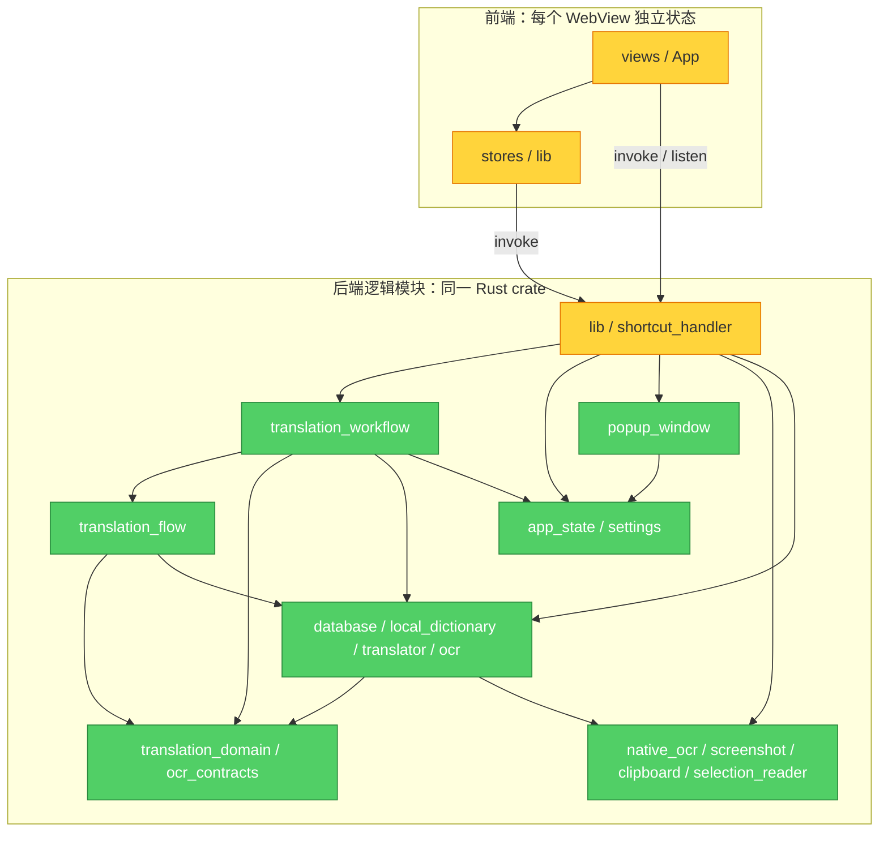

# 架构与代码质量审计

Mode: Architecture Audit

## Module Dependency Graph



图为逻辑 Module 聚合图（不是精确逐文件 fan-out 计数）；IPC 边代表协议依赖。绿色仅指本次架构子审计没有独立确认缺陷，不代表其他审计通过。最广的生产装配/控制依赖位于 `lib.rs`；这是 composition root 的预期职责，不能据文件大或依赖多直接报错。

## 范围、方法与限制

- 基线由上下文任务固定为 `d72a76967f3f79d0e51eae4c049889d32f2e9a42`。已阅读 `context.md`、`AGENTS.md`、`docs/agents/{domain,issue-tracker,triage-labels}.md` 与 `docs/architecture-translation-workflow.md`。
- 已加载 `brooks-audit`、`codebase-design`；前者指定的 `_shared/common.md`、`source-coverage.md`、`decay-risks.md` 在本机技能目录不存在，无法采用未取得的书籍归因/评分公式。因此不编造 Health Score，使用可读取的 architecture-guide 六项扫描及“症状 → 来源 → 后果 → 最小修复”证据链。
- 深读：`translation_flow`、`translation_workflow`、前端 translation/settings stores、App、PopupWindow、Translate/History/Favorites/Detail 页面及其调用者；抽查 lib 命令/装配、settings、local_dictionary、popup_window、shortcut_handler、database。读取 package/Cargo manifest、Rust imports，确认当前调用链。HomePage 未注册在当前 router，不将其行为当作活动入口证据。
- 未改源码、未启动代理、未启动应用、未读用户数据库/配置/剪贴板；仅增加此审计产物。未运行完整测试或原生多窗口测试。ARCH-02 做了实际源码的隔离执行，见下。
- P0/P1：本子审计未确认。两个建议 P2 候选交 triager 独立复核；另列两个产品/文档待决项，不应自动变成修复工单。

## 候选问题

### ARCH-01 — 跨窗口持久化更新没有使已挂载的历史/收藏/详情视图失效

- **建议：P2；置信度：高（静态调用链），状态建议：needs-triage。**
- **症状 / 实际入口：** 主窗口停留历史或收藏页，在其他应用中使用划词快捷键生成翻译，或在弹窗收藏/取消收藏后回到原主窗口，页面仍显示旧列表/星标。关闭并重开主窗口若只是 hide/show 不会重新 mount。离开再进入列表通常恢复，故不是持久化丢失。
- **来源 / 证据：**
  1. `src/main.ts:14-15,27` 每个 WebView 启动各自 Pinia；`src/views/PopupWindow.vue:9,38-40` 又单独持有当前记录。
  2. 弹窗 `toggleFavorite` 在 `PopupWindow.vue:112-124` 调 `toggle_favorite`，成功后只更新自身记录；后端 `src-tauri/src/lib.rs:505-509` 只写数据库、不 emit 失效事件。
  3. 快捷键路径 `shortcut_handler.rs:79-96,190-237` → workflow 持久化 `translation_workflow.rs:204-229` → `popup_window.rs:446-467` 只发给 popup window。主窗口没有收到 persisted-record 变化通知。
  4. 主窗口 `src/App.vue:64-75` 只订阅 OCR 原文和导航；`src/views/HistoryPage.vue:19-21` 只在 mount 调 loadHistory；`FavoritesPage.vue:10-18` 是页面自己的列表，仅 mount/当前页面 remove 时重新查；`DetailPage.vue:10-15` 仅 mount 加载记录。对应源码未发现 focus/visibility 或记录变更订阅。
- **后果：** 两个受支持窗口展示同一持久化记录的不同版本；已打开收藏页不能看到弹窗新收藏，已打开历史页不能看到刚查询记录，已打开详情页的下一次收藏操作会基于旧状态计算目标。不是类型定义重复或风格问题，而是 canonical database 的通知协议缺项。
- **复现思路：** 隔离测试数据启动应用；主窗口先进入 `/favorites`（空列表）；在其他窗口选取 hello 并按划词快捷键，等待完成后在 popup 收藏；关闭 popup、恢复原主窗口，不导航其他路由，观察仍为空；再离开并回到 `/favorites`，记录出现。历史页相同方式复核。mock 层可模拟 DB mutation 与两个 WebView 的独立状态，但不能替代真实窗口验收。
- **最小修复范围：** 在成功记录写入/收藏更新处建立一个明确的记录变化通知 Interface；主窗口集中消费，更新 store，且 Favorites/Detail 不能继续保留无法失效的独立副本（可按记录 ID 统一读取或明确订阅失效）。若先做更小的 focus-reload，必须覆盖当前列表与详情的本地状态，不能只 reload store.history。不要引入通用事件总线或重写 workflow。
- **回归：** 主窗口保持挂载时，popup 新增、enrichment、收藏/取消收藏各一次；焦点恢复后所有正在显示的同 ID 记录一致；写库失败不得发送成功变化。

### ARCH-02 — 收藏写入失败被 store 吞掉，详情页仍显示操作成功

- **建议：P2；置信度：高（实际源码隔离执行确认），状态建议：ready-for-agent。**
- **症状：** 数据库写入失败时，详情页收藏星标仍被切换；重新进入详情后又恢复旧值，当前页没有失败提示。
- **来源 / 证据：** `src/stores/translation.ts:102-118` 在 invoke 失败后只设置 error，函数正常 resolved；`src/views/DetailPage.vue:25-30` await 后无条件修改自己的 `translation.is_favorite`。页面模板 `:44-124` 不渲染 store.error。因此 caller 无从分辨成功/失败。与 Settings store `settings.ts:114-116` 显式 rethrow 不同，说明 error Interface 不一致已经造成可观察的错误，并非要求风格统一。
- **后果：** 向用户虚报已收藏/已取消收藏；数据库和其他页面保持旧状态。可由只读目录、磁盘/SQLite 错误触发；不需要并发或跨窗口。
- **隔离复现已执行：** Node v24.14.1，以内置 `node:module.stripTypeScriptTypes` 去除类型，通过 `vm` 加载真实 `translation.ts` 与 `DetailPage.vue` script-setup，注入最小 ref/Pinia/router，令 `get_translation_by_id` 返回 `{id:1,is_favorite:0}`、`toggle_favorite` 抛出 `synthetic DB failure`；执行真实 mount 回调和真实 detail.toggleFavorite。退出码 0，输出：
  ```json
  {"persistedFavorite":0,"detailFavorite":1,"storeError":"更新收藏状态失败: Error: synthetic DB failure"}
  ```
  未写测试文件、未连接 DB、未执行 DOM/native。最初尝试 TypeScript transpileModule 因本地无 `typescript` 包失败（ERR_MODULE_NOT_FOUND），随后使用 Node 内置剥离执行成功；不把初次环境错误报成项目缺陷。
- **最小修复范围：** `translation.ts::toggleFavorite` 明确返回成功值/持久化记录或抛出错误；`DetailPage.vue::toggleFavorite` 仅成功时更新、失败时显示消息；同步核对 `FavoritesPage.vue:30-35` caller 防止引入未处理拒绝。不需要改 Rust 或重构数据库。
- **回归：** invoke reject 时详情星标/记录不变并显示错误；resolve 时更新；取消收藏失败时收藏列表仍保留条目；避免仅测试 store.error。

## 产品/协议待确认项（不作为已确认缺陷计数）

### ARCH-Q1 — 本地词典缺失到底是显式失败还是可降级？

- `lib.rs:610-619` 在未找到词典时记录“单词查询将使用 Free Dictionary”，实际 `local_dictionary.rs:62-76` 返回 Err，`translation_flow.rs:87-88` 立即传播，根本不会调用 Free Dictionary/provider；普通 ASCII 单词路径受影响，句子路径不受影响。
- 反证必须保留：`translation_flow.rs:565-590` 专门测试 `local_lookup_error_stops_before_online_collaborators`；这说明不能仅凭一条启动日志就擅自把 fail-fast 改为远程发送。读取失败与 miss 的区分可能是有意的数据完整性策略。
- 建议 `needs-info`：确认**缺失文件**是否应区别于损坏数据库。如果产品确认降级，建议 P2、最小修改缺失资源 → unavailable/miss 的策略（不要吞掉全部 DB 错误），加覆盖；若产品要求 fail-fast，只纠正启动信息即可，不应创建功能缺陷修复票。

### ARCH-Q2 — OCR profile 是单一 small 还是允许旧 tiny/medium？

- 架构文档 `docs/architecture-translation-workflow.md:114` 允许 tiny/small/medium；`settings.rs:87-89,112-124` load normalization 与 `lib.rs:100-109` 更新强制 small 使用不同规则；`SettingsPage.vue:136-143,184-186,219-220` 明确产品 UI 固定 small。
- 因 UI 本身固定 small，未找到当前正常 UI 选择 tiny/medium 然后被悄然改回的路径，不上报此类虚构缺陷。旧配置迁移期望需确认；最小范围是统一文档/迁移规则，而非新增 profile 下拉框。

## 架构扫描结果与测试 Seam 评估

| 扫描项 | 结果与取舍 |
|---|---|
| Dependency disorder | 入口 → workflow → flow / contracts 方向清楚，未确认生产调用环。flow 引用 local_dictionary 的 DTO/纯 merge；这降低实现隔离，但未证明现存功能后果，故不发“必须再加一层”工单。 |
| Domain model distortion | `TranslationResult` 与持久化 `TranslationRecord` 分开；workflow 返回持久化记录，Vue 不重复 save，符合架构文档。 |
| Knowledge duplication | TS/Rust 手写 records、provider fake 中复制生产 key 检查（`translation_flow.rs:347-391` 对比 `translation_workflow.rs:361-403`）。测试会验证 fake 自己的分派，不等同实际 AppProviderGateway；这是覆盖限制，未据此断言生产分派有 bug。 |
| Accidental complexity | workflow 不是无意义 pass-through：配置快照、OCR、首次保存/enrichment 不增计次、取消、阶段报告集中在小 Interface 下，删除会将复杂度重新散落入口，具有 Depth。 |
| Change propagation | 已确认 ARCH-01：跨窗口副本的失效知识没有明确 owner；ARCH-02：mutation 的成功/失败契约泄漏到 caller。 |
| Cognitive overload | lib 同含装配与命令较长，但相关职责可定位，未把文件长度或命名偏好当缺陷。 |
| Testability Seam | DictionaryGateway、ProviderGateway、TranslationRepository、RuntimeSettingsSource、OcrGateway 均有生产 Adapter 与 fake Adapter，是真实 Seam；配置快照、持久化次数、取消在 Interface 上可测。窗口事件/IPC 成功失败需要跨层契约测试，目前本次仅完成 ARCH-02 无 DOM 验证；原生集成覆盖由 tests 成员报告。 |
| Conway's Law | 未取得项目开发团队所有权/协作痛点证据，跳过；此次审计成员分工不是产品组织结构。 |

## 交叉审计与未验证清单

- 已向 tests 移交活动 `TranslatePage.vue:67-69,108-113` 键盘提交绕过 loading 限制的线索；不在此重复主报。`HomePage` 不在 router，提醒以活动页面作为证据。
- runtime 主报 settings 内存/磁盘原子性、截图 guard、剪贴板、OCR status/restart；本报告不重复定级。
- 安全/安装包/原生 DPI/真实多窗口事件时序/网络服务响应未验证；未根据现有架构图推断 Tauri 权限已隔离。
- 未证实 provider 返回乱序造成 overlay 错配；`align_overlay_blocks` 等行数映射是外部假设，缺少真实反例，未当 bug。
- 建议优先复核 ARCH-02（隔离执行已确认，变更范围小），随后 ARCH-01（需原生双窗口验收）；Q1/Q2 先定产品期望，不能与已确认缺陷混算。
