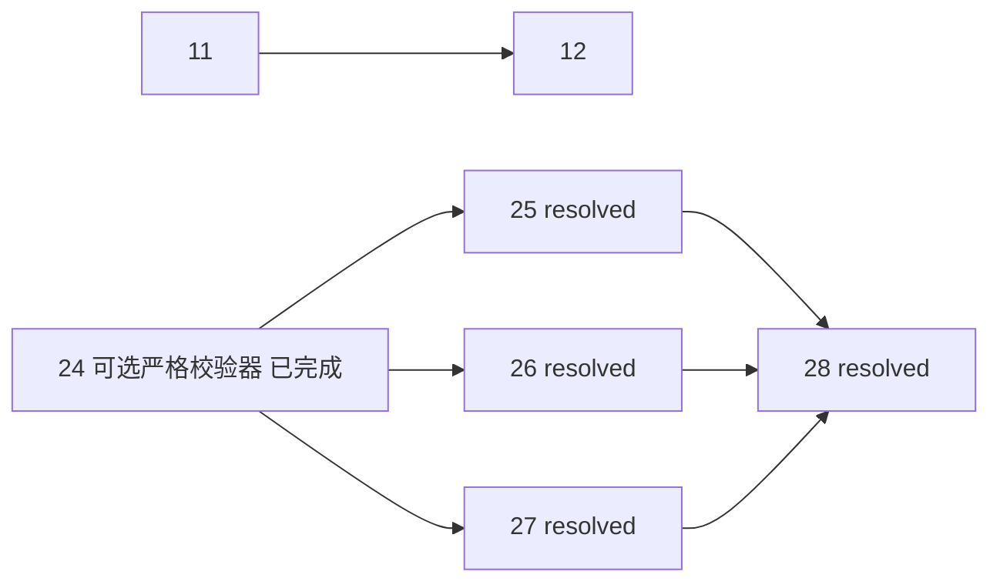
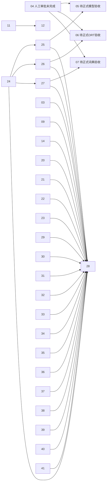
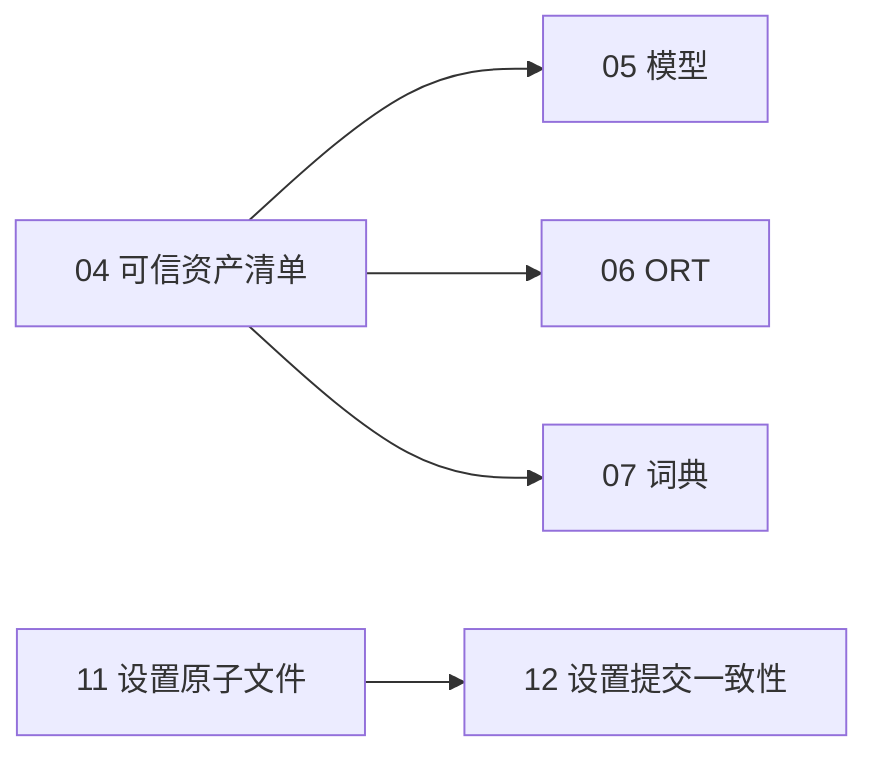
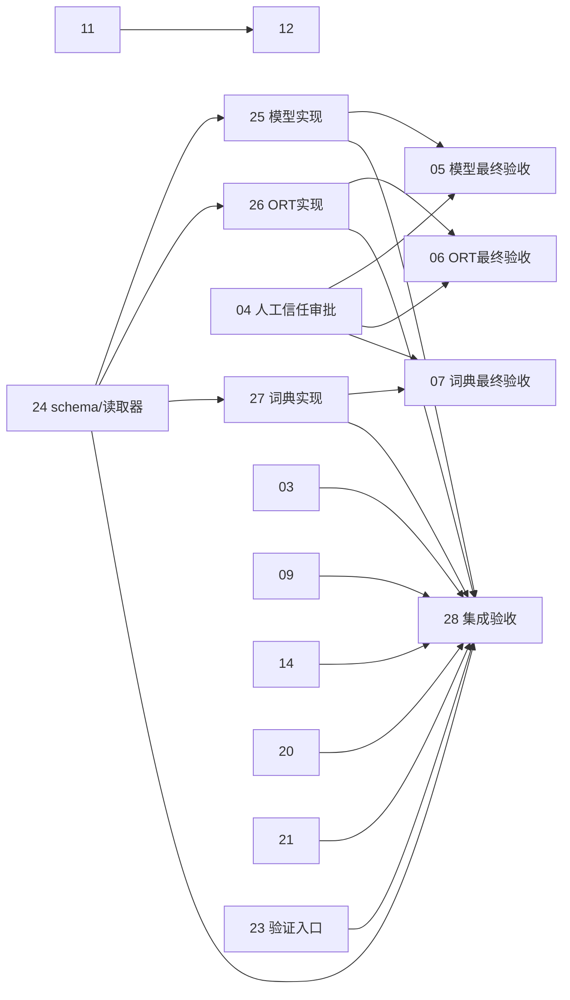

# Repository audit map

日期：2026-10-22；基线：`d72a76967f3f79d0e51eae4c049889d32f2e9a42`。规格见 [spec](spec.md)。本图顶部为负责人最终裁决的工单状态/依赖索引；关闭范围受最终验证边界约束，不是全产品验收保证。

## Notes — 最终工单索引

共 **41票：37 resolved、4 wontfix（04–07）、0待办**。25–28依据最新默认路径执行与独立review PASS关闭；25在接手时已resolved，26–28本次同步为resolved。04–07按用户个人工具要求取消强制审批，不是验收通过；24仍resolved，仅保留可选严格校验器。

最新证据（用户提供，非本文维护者重跑）：Python25通过；PS5.1/7模型各21、ORT各45通过；独立默认路径review PASS；主代理最终串行全树npm181/build/E2E1、Node wrapper+dependency smoke11、Rust check exit0及110+4+15=129通过；git diff --check exit0。真实资产下载/GUI/原生信号/跨平台 NOT RUN，Rust14版本公告残余保留，不宣称无漏洞。详见 [最终验证](final-verification.md)。

历史中间状态：33 resolved/4 wontfix/4 claimed，已被本次最终37/4取代。

现行范围：无ManifestPath默认官方固定版本，不读取release-assets.json；模型用已获取官方SHA256；ORT无hash时检查大小/唯一ZIP条目/PE版本；词典结构检查+按revision缓存；全部失败保留旧文件。显式manifest仅可选严格模式。结构检查不构成正式资产可信背书，真实推理/安装包未验证边界不变。

历史口径（已取代）：此前依据 [final-verification.md](final-verification.md) 为37 resolved、3 ready-for-agent、1 ready-for-human；关闭25票（03/09/14/20/21–41）。旧证据及人工blocked记录保留在下方历史区，不能覆盖本次最终37/4状态。

| 编号 | 主题 / 文档 | Status | Blocked by |
|---|---|---|---|
| 01 | [Google错误凭据](issues/01-google-error-secret.md) | resolved | none |
| 02 | [日志路径边界](issues/02-log-path-boundary.md) | resolved | none |
| 03 | [全文日志政策](issues/03-text-log-policy.md) | resolved | none |
| 04 | [取消独立资产审批](issues/04-approved-asset-manifest.md) | wontfix | none |
| 05 | [取消模型正式背书门槛](issues/05-model-content-verification.md) | wontfix | none |
| 06 | [取消ORT正式背书门槛](issues/06-ort-content-verification.md) | wontfix | none |
| 07 | [取消词典正式背书门槛](issues/07-dictionary-content-verification.md) | wontfix | none |
| 08 | [剪贴板格式](issues/08-clipboard-format-preservation.md) | resolved | none |
| 09 | [取消自动Ctrl+C](issues/09-clipboard-restore-ownership.md) | resolved | none |
| 10 | [截图会话guard](issues/10-screenshot-session-owner.md) | resolved | none |
| 11 | [设置原子文件](issues/11-settings-atomic-file.md) | resolved | none |
| 12 | [设置提交一致性](issues/12-settings-commit-consistency.md) | resolved | 11 |
| 13 | [OCR真实状态](issues/13-ocr-runtime-status.md) | resolved | none |
| 14 | [Windows正式支持范围](issues/14-nonwindows-support.md) | resolved | none |
| 15 | [main副本重新校验](issues/15-main-view-revalidation.md) | resolved | none |
| 16 | [收藏失败协议](issues/16-favorite-failure-contract.md) | resolved | none |
| 17 | [手动翻译busy](issues/17-manual-translation-busy.md) | resolved | none |
| 18 | [E2E断言](issues/18-e2e-result-locator.md) | resolved | none |
| 19 | [Node契约](issues/19-node-support-contract.md) | resolved | none |
| 20 | [词典缺失策略](issues/20-dictionary-unavailable-policy.md) | resolved | none |
| 21 | [OCR profile契约](issues/21-ocr-profile-contract.md) | resolved | none |
| 22 | [依赖公告核实（非全部修复）](issues/22-dependency-advisory-verification.md) | resolved | none |
| 23 | [Rust资源测试边界](issues/23-rust-resource-test-seam.md) | resolved | none |
| 24 | [可选严格校验器](issues/24-asset-manifest-schema.md) | resolved | none |
| 25 | [模型默认路径](issues/25-model-integrity-impl.md) | resolved | 24 |
| 26 | [ORT默认路径](issues/26-ort-integrity-impl.md) | resolved | 24 |
| 27 | [词典默认路径](issues/27-dictionary-integrity-impl.md) | resolved | 24 |
| 28 | [新默认路径集成验证](issues/28-round-integration-acceptance.md) | resolved | 25, 26, 27 |
| 29 | [Vite/CSS](issues/29-vite-css-toolchain-advisories.md) | resolved | none |
| 30 | [Vitest/mocker/UI](issues/30-vitest-mocker-ui-advisories.md) | resolved | none |
| 31 | [Vue](issues/31-vue-renderer-advisory.md) | resolved | none |
| 32 | [YAML](issues/32-router-yaml-advisory.md) | resolved | none |
| 33 | [brace-expansion](issues/33-brace-expansion-advisories.md) | resolved | none |
| 34 | [js-cookie](issues/34-test-utils-cookie-advisory.md) | resolved | none |
| 35 | [Undici](issues/35-jsdom-undici-advisories.md) | resolved | none |
| 36 | [Tauri origin补丁](issues/36-tauri-origin-advisory.md) | resolved | none |
| 37 | [TLS/HTTP2补丁](issues/37-reqwest-tls-h2-advisories.md) | resolved | none |
| 38 | [anyhow](issues/38-anyhow-downcast-advisory.md) | resolved | none |
| 39 | [crossbeam-epoch](issues/39-crossbeam-epoch-advisory.md) | resolved | none |
| 40 | [serde_with](issues/40-serde-with-advisory.md) | resolved | none |
| 41 | [Windows plist/XML](issues/41-plist-xml-advisory.md) | resolved | none |

## 当前 DAG（范围收缩后）

共7条边：11→12；24→25/26/27（已完成的可选严格校验器兼容前置）；25/26/27→28。04–07无前置、无后继，不再形成审批门槛。

拓扑层0：01–11、13–24、29–41；层1：12、25–27；层2：28。25–28及其前置均resolved，无人工审批阻塞或待办。这里只维护文档，不派代理、不执行产品测试。

## 最终文档机械校验（2026-10-22）

Python只读校验exit0：01–41编号唯一连续；37 resolved/4 wontfix（04–07）；41行map与票面Status/Blocked by一致；7条依赖及当前Mermaid边集合一致、无环；整个审计目录129个本地Markdown链接目标有效（不校验页内锚点）。首次校验exit1是将tests.md内联代码误识别为链接；排除代码块/内联代码后定点修正解析并通过，未修改被检文档内容来掩盖失败。本次没有产品测试构建。

## 历史中间状态文档校验结果（2026-10-22）

Python只读机械校验exit0：01–41连续唯一；33 resolved/4 wontfix/4 claimed；41行当前map索引与票面Status/Blocked by一致；7条边引用有效、无环，当前Mermaid边集合与票面完全一致；工单/map/spec/final-verification共123个本地Markdown链接目标有效。04–07均wontfix且无前置，28仅依赖25–27，均通过断言。本次未执行产品测试，未验证新代码或真实资产。

## 历史关闭快照（以下全部旧状态/依赖/统计仅指记录当时）

旧人工blocked及中间33/4/4结论已由顶部最终37/4取代；旧图不是现行DAG。保留旧执行证据和失败，不将范围取消写成验收通过。

## Decisions-so-far — 历史最终关闭与保留边界

各索引链接指向本轮票的 Answer/Comments；权威执行记录为 [最终验证](final-verification.md)，不是本次文档同步重跑产品测试。
- 03 内容日志及二次泄漏修正、09 用户批准取消自动 Ctrl+C、20 fail-fast、21 small 归一均独立复核通过。09 旧 PARTIAL 已取代，仅作历史。
- 14 按 Windows 正式支持范围关闭；Linux/macOS NOT RUN，不宣称跨平台成功。
- 23 CLI 真实退出码测试完成，但 Windows 真实 POSIX 信号传播 NOT RUN，模拟结果不代替原生实测。
- 24–27 机制完成；04 仍待独立批准摘要/审批人，05–07 被人工信任阻塞。未有生产清单、真实资产/模型推理/安装包验收，28 resolved 不解除它们。
- 29–41 指定依赖补丁与已批准兼容回归关闭；36–41 真实 origin 隔离、GUI/窗口操作、HTTP2 端到端 NOT RUN。
- **22 只关闭公告核实；Rust 仍14个版本命中公告**（最终771版本查询）。Windows rand0.7.3旧构建链及fxhash/paste/ttf-parser维护公告，树外glib/memmap2/旧XML等仍保留。Windows plist旧XML由41修复。不能称Rust全图无公告；见 [残余详情](final-verification.md) 与 [原始逐ID报告](dependency-advisories.md)。

## 历史 DAG 与统计（旧人工门禁）

边为前置→后继，共34条：04→05/06/07；25→05、26→06、27→07；24→25/26/27；11→12；03/09/14/20/21/22/23/24/25/26/27/29–41→28（24条）。

拓扑层0：01–04、08–11、13–24、29–41；层1：12、25–27；层2：05–07、28。28 不依赖04–07，所有24个前置已 resolved；05–07 各有已完成机制前置及未完成04信任前置。暂无可直接执行的开放前沿。

## 历史快照与原始决策（以下非现行状态）

以下所有“当前/现行/本次”只指各历史记录当时；保留旧失败、旧统计和边界，均不覆盖上方最终状态与 [最终验证](final-verification.md)。

### 2026-10-22 第二阶段（批准计划 `vectorized-scribbling-puppy.md`）

用户已明确审批该计划。产品决策：03 info/debug 均不记内容、无敏感日志开关；09 取消自动 Ctrl+C 回退（用户批准的范围变更，非启发式修补）；14 仅 Windows 为正式已验证平台；20 保留 fail-fast 并修提示；21 正式仅 small、旧 profile 归一。04 仍为人工信任阻塞，未获批准。新增 24–28；22 派生修复票从 29 起，取得证据后才建。

| 状态 | 上次同步 | 当前 |
|---|---:|---:|
| resolved | 12 | 12 |
| claimed | 0 | 4（03、09、21、24） |
| ready-for-agent | 4 | 10（05、06、07、14、20、23、25、26、27、28） |
| needs-info | 5 | 1（22） |
| ready-for-human | 1 | 1（04） |
| needs-triage | 1 | 0 |
| 总数 | 23 | 28 |

`claimed` 表示已派发、正在实施，不代表任何验收证据。05–07 为 ready-for-agent 但被 04（人工）阻塞，24–27 通过不能解除；28 不依赖 05–07，但其报告须列出 05–07 为等待人工信任材料。本节尚无任何执行证据。

### 历史第一阶段 vs 初始状态（2026-10-22）

> 第一阶段历史快照；现行统计见上方“2026-10-22 第二阶段”表。

| 状态 | 初始审计 | 当前 |
|---|---:|---:|
| resolved | 0 | 12 |
| ready-for-agent | 16 | 4 |
| needs-info | 5 | 5 |
| ready-for-human | 1 | 1 |
| needs-triage | 1 | 1 |
| 总数 | 23 | 23 |

当前关闭：01、02、08、10、11、12、13、15、16、17、18、19。当前ready-for-agent：05、06、07、09。05–07仍被人工04阻塞；**09已部分修复，整体PARTIAL，保持ready-for-agent**。最终补强静态PASS；tests提供第二轮冻结树`clipboard::tests`14 passed、`shortcut_handler::tests`11 passed、`cargo check --tests` exit0，全量115+4+15=134 passed、0 failed/ignored/skipped，命令均exit0（第一轮131是旧树历史）。已加快照锁内稳定sequence与注键前过期拒绝（零键/零恢复）、应用事务串行化、锁内token比较→恢复、无token不恢复及注键错误传播/尝试Release；真实A/B线程只覆盖生产锁seam，不是Win32实验。未解决同PID主动/延迟写入归因及检查→注键竞态，未做真实Win32验证，不拆票弱化验收。逐票Status/Severity复核确认：01是唯一已确认P1且已resolved；当前无已确认P0或未关闭的已确认P1，不构成全仓安全保证。后续实现阶段负责人明确采用`resolved`作为关闭值；原spec及末尾初始校验中的五值统计是分诊阶段历史，不应当作当前关闭协议。

08经负责人批准关闭：方案A白名单文本族原始字节快照/恢复，静态PASS，稳定树`clipboard::`10 passed、`shortcut_handler::`7 passed、全量126 passed/0 failed、`cargo check --tests` exit0。**不构成完整剪贴板保护**：08关闭时09的备份—恢复竞争与enigo错误吞噬未修复（09现已部分修复，见上方现行结论，仍不完整），真实Win32往返未测，owner延迟渲染可能阻塞、EmptyClipboard后部分Set失败不可回滚。

13经负责人批准关闭：生产生命周期seam与纯投影，稳定树`native_ocr::lifecycle_tests`6 passed、`ocr_contracts::tests`6 passed、全量126 passed/0 failed、`cargo check --tests` exit0。保留边界：Ready在build完成后、RUNTIME安装前有短窗口；failure仅按profile、progress全局；未验证RUNTIME锁中毒恢复；未跑真实模型/DLL/UI视觉。13代码冻结不清理。

15自动化PASS；原生onFocusChanged双窗口未验证，属环境限制延期，非已通过。负责人已明确接受此非阻塞残余风险后关闭。E2E 1 passed仅mock黄金路径辅助回归。19已统一README/package.json/lock根为项目Node>=24.0.0、20/22非支持、24.14.1唯一实测。

11与12依现有22项settings、6项app_state执行及独立复核关闭；12并发测试当前只检查两次调用完成及最终值属于候选之一，未独立记录持久化先后次序，不能当作强交错证明；生产互斥仍由源码审核支持。10移除stale强解锁解决正常会话互斥，但当前token每次重取为2，不具备跨代唯一性；模拟1000替换测试不等于真实取消/替换协议，未实现该协议也非关闭条件。原生GUI/ESC、真实磁盘/UI故障注入仍按各票保留。

本次同步验证：Grep逐票读取23项Status/Blocked by，Glob确认23个链接目标文件，人工比对索引一致；四条边仍为04→05/06/07、11→12，无环（其余无前置）。尝试Python机械复验时Bash在执行前exit5（Git add_item错误），因此本次为工具读取+人工图校验，不冒称脚本通过；初始机械校验记录保留为历史。没有运行cargo。

## Decisions-so-far — 逐候选复核

| 原候选 | 处置 / 独立质疑结果 |
|---|---|
| SEC-01 | 01采纳P1。独立读锁定reqwest0.13.2 Display，send错误含query key；正常断网可达。JSON decode不附URL的反证保留；未证明外传，不P0。 |
| SEC-02 | 02采纳P2。真实函数lexical starts_with不处理..；合成目录已复现。常规UI仅枚举文件，无已知远端脚本入口，拒绝“远程任意文件读/P1”的夸大。 |
| SEC-03 | 03 needs-info。默认info全文事实成立；用户知情/诊断需求不清，先定政策。 |
| SEC-04 | 04→05/06/07。缓存存在性不保证完整性，可变revision破坏复现；未证明上游/包被篡改，不RCE/P1。一个共同缺口分三个边界实现，04不另算缺陷。 |
| R1 | 08采纳P2。read_text备份无法保真；UIA成功不走fallback，影响有条件。允许无法备份时拒绝，不要求实现全格式管理器。 |
| R2 | 09采纳P2。restore无所有权检查，sequence只用于读等待；应用mutex不能防用户外部复制。与R1非重复。 |
| R3 | 10采纳P2。旧会话可能仍活，时间清bool/旧Drop解锁有明确交错。无内存破坏证据；最小方案可取消stale强制解锁。 |
| R4 | 12采纳P2。更新后持久化Err不回滚；API/theme/tray合并。快捷键专门补偿是反证边界，不全盘推翻。 |
| R5 | 11采纳P2。截断写+parse失败默认回退；序列化失败不会截断，但中途I/O仍可损坏。未真实断电，不假称实测。 |
| R6 | 13采纳P2。model_status只认文件，不认runtime；未预热和初始化失败均可假健康。restart另列Fog不顺带实现。 |
| R7 | 14 needs-info。父模块Screen未import、app按值move后borrow静态成立，但当前Windows cfg不受影响；先定平台承诺再拆所需实现。 |
| ARCH-01 | 15采纳P2。main各页只mount加载，不存在focus刷新；回路由可恢复，非DB丢失。采用窄focus重新校验契约，不强制事件总线。真实双窗未跑。 |
| ARCH-02 | 16采纳P2。triager真实store注入reject不传播；详情无条件改副本；Popup自己catch不应重复报。 |
| ARCH-Q1 | 20 needs-info。启动提示与错误传播矛盾，但有专门fail-fast测试；不擅自改隐私/远程fallback策略。 |
| ARCH-Q2 | 21 needs-info。文档/旧配置与单small不同；当前UI无profile选择，拒绝虚构“用户选择被重置”。 |
| TEST-01 | 17采纳P2。triager重跑真实store逆序返回，确认current旧/提前loading false；当前TranslatePage可达，不依赖HomePage。 |
| TEST-02 | 18采纳P2。原测试失败但快照有译文，heading/region语义错；拒绝“翻译失效”归因。 |
| TEST-03 | 19采纳P2。独立读取lock engines与README18矛盾；只有Node24实测，拒绝声称已跑Node18崩溃。 |

## DAG 与校验

> 以下“四条依赖”段为第一阶段历史；现行图见本节末“2026-10-22 第二阶段现行 DAG”。

必要依赖只有四条：`04 → 05`、`04 → 06`、`04 → 07`、`11 → 12`。其余节点独立。人工04的信任审批不能由脚本自动推断完成。

拓扑层0：01、02、03、04、08、09、10、11、13、14、15、16、17、18、19、20、21、22、23。层1：05、06、07、12。研究/needs-info节点在层0只代表无图依赖，不代表可直接实施。文档校验应检查23编号连续唯一、依赖存在、无self-edge/环、Status规范、map链接可解析；实际校验结果追加在下方Comments。

### 2026-10-22 历史第二阶段 DAG（旧技术/信任依赖）

边清单（共 20 条）：04→05、25→05、04→06、26→06、04→07、27→07、24→25、24→26、24→27、11→12、03/09/14/20/21/23/24/25/26/27→28。拓扑层0：01–04、08–11、13–24（含resolved）；层1：12、25、26、27；层2：05、06、07、28。05–07 与 28 无边：28 可在 04 未批准时执行，但需如实报告 05–07 阻塞。22 派生修复票（29+）建立后加入 →28。“23 → 受资源阻塞的 Rust 验证”体现为 23→28（14/20/21/03/09 的 Rust 定向执行在 28 内由唯一执行者经 23 入口完成）。

### 文件调度锁（不是技术依赖，不写入 Blocked by）

| 共享文件 | 顺序 / 规则 |
|---|---|
| `src-tauri/src/shortcut_handler.rs` | 03 → 09 |
| `src-tauri/src/translation_flow.rs` | 03 → 20 |
| `src-tauri/src/lib.rs` | 21 → 20 |
| `screenshot.rs`、`screenshot/webview.rs` | 14 独占 |
| 资产清单文件（24 定义路径） | 24 单 owner；04 研究/填写不得与 24 同时修改 |
| `prepare_ocr_models.ps1` / `prepare_ort_runtime.ps1` / `build_dictionary.py` | 分别 25 / 26 / 27 独占 |
| README、package.json、package-lock.json、Cargo.toml/lock、spec.md、map.md | 主负责人统一合并；各实施者提交待合并说明，不直接改 |
| Rust 构建/测试 | 任意时刻仅 1 名执行者，经 23 入口，目标目录由调用者配置在 C 盘 |

当前派发：03、09、21、24 已 claimed（三名源码代理 + 本 triager 只写 `.scratch`）。按上表，09 写 `shortcut_handler.rs` 须等 03 交接；20 须等 03 与 21 交接。

## 建议修复批次与文件所有权（由负责人派发，不自动启动）

### 批次A：高风险小票与恢复可用门禁

- **security**：01先修，独占 `src-tauri/src/translator.rs`及相应生产formatter测试；之后02独占`logger.rs`。03政策未决不得顺带改全文日志。
- **tests**：18（唯一E2E文件）→19（README/package.json、根lock metadata），并研究23的资源/测试环境；不伪造资源。可与security并行。
- **runtime**：11先实现（settings.rs）→12（app_state.rs及必要lib.rs）。同一人维护事务协议，防止各自假设。
- **architecture / 前端store唯一owner**：17→16→15按此顺序，小提交小回归；三票共享translation.ts/Detail等，不分给并行写同文件的成员。若17由tests实施，合并验收后明确交接store所有权给architecture再做16/15。

### 批次B：原生正确性

- runtime按08→09同一剪贴板owner执行；共同写clipboard.rs/shortcut_handler.rs，两票仍单根因。
- 10截图guard独占screenshot.rs，先做无需跨平台决定的安全最小修复。14未决，不并发改该文件。
- 13 OCR状态一个owner负责Rust DTO到前端设置；涉及SettingsPage/settings store，与12如触及相同lib.rs串行或明确块级交接。原生回归环境必须先确认，不为批次进度将blocked记passed。

### 批次C：发布资产

- 维护者完成04，提供不可变来源+真实可信摘要；随后05/06/07可各自并行，各只改自己的准备脚本和测试，清单由04单owner维护。
- 发布资源合并、产物内容核验另列Fog；不能靠05–07局部通过宣称安装包完整。

### 待决队列

03日志政策、14平台范围、20词典策略、21旧profile迁移由产品/平台负责人答复后再派细化实现；22获得包级advisory证据后才定级/建修复；23先研究测试边界。无需为了“清零”强制将这些票转ready或wontfix。

> 2026-10-22 更新：03/14/20/21 已由用户审批计划答复（见上方第二阶段节），23 选定测试入口方案；本待决队列仅剩 22（证据）与 04（人工信任）。

## Fog — 驳回、待验证与未覆盖

“驳回”仅指本次证据不足以作为所声称的确证漏洞，不等于长期wontfix。

### 已拒绝的过度归因 / 不立实现票

- 文件大、依赖fan-out、DTO重复、workflow不是纯pass-through：未证明行为后果，不能报P0/P1或要求架构重写。没有真实团队组织数据，不做Conway评分。
- SQL拼接：用户值参数绑定，动态列来自固定集合；不报SQL注入。WordNet extractfile未写归档路径，不报zip-slip。
- CSP=null、未采用系统密钥库、get_settings返回秘密：加固/信任模型问题，未证明XSS/远端执行；不报现成RCE。inline capabilities不能简单与文件capabilities相加，也不能自动隔离未配置app manifest的自定义command。
- ONNX DLL搜索CWD/环境变量：需资源缺失+攻击者目录影响等前置；当前无利用链，不独立报已证实DLL劫持。上游hash缺失本身不证明发布产物恶意。
- Google JSON decode：锁定0.13.2不附URL，不能拿0.13.5源码推广。
- 词典缺失：已有专门fail-fast测试，不能未经批准自动向网络降级（20）。
- 测试chunk大小警告、初始node_modules缺失、helper实验stub不完整：不是产品bug。

### 待验证候选（本轮不自动建实现票）

| 线索 | 为什么未确证 / 下一步证据 |
|---|---|
| Audio URL scheme/host | 用户点击远端词典audio，未测WebView scheme/私网边界；需可信媒体策略和受控响应实验，不称服务器SSRF。 |
| 图片/JSON输入大小 | 无应用上限不等于OOM；核对image默认限制并在受限环境量测，不在用户机器巨量输入。 |
| 取消检查→DB保存竞态 | 需先定义已展示本地阶段是否应撤销；合作式取消不等于全局事务，缺执行反例。 |
| DB UPSERT后SELECT并发返回 | 可在间隙读最新同key记录，但产品按请求/按key契约未定；需双连接可控交错测试。 |
| Win32错误路径资源清理 | HWND/类/brush部分失败路径可疑；需逐处故障注入及句柄计数，未证普通操作泄漏。 |
| popup ready check-then-once | 理论事件窗口，预热减少触发；需可控真实事件调度复现。 |
| 快捷键注册/反注册漂移 | old_shortcut来源、规范化、错误忽略需隔离真实注册验证；已有补偿路径必须保留。 |
| OCR restart其实ensure | 同profile复用而非销毁，尚无UI按钮用户故障证据；先定restart契约，不混入13。 |
| overlay行数相等zip | provider顺序假设未找到实际反例，不报已错译位置。 |
| native resource overlay | base有dictionary、overlay只模型/DLL，尚未验证实际Tauri merge和安装产物；需resolved config与隔离安装包清单/启动，不能从frontend build证明完整。 |

### 环境阻塞与明确未覆盖

- Rust test/check卡在正式dictionary.db资源（23）；真实模型/DLL未准备，不能声称Rust编译/全157以外测试通过。
- 未跑真实Tauri多窗口、Win32选区/剪贴板、多显示器混合DPI、快捷键并发、OCR模型推理/初始化panic、大图压力、原生死锁压力。
- 未执行Linux/macOS target检查（14）；没有跨平台成功声明。
- 无完整网络provider超时/错误集成；01 formatter/源码证据不等同真实IPC+磁盘日志捕获。
- 未联网同步npm/cargo advisories（22），未审第三方原生内存安全；没有“依赖无CVE”结论。
- 未查远端仓库权限、branch protections、CI/release签名与provenance、实际发布资产；tracked .github无文件不证明远端无治理。
- 架构技能部分共享参考文件缺失，未编造书籍评分或Health Score；见architecture.md范围说明。

## Comments

2026-10-22：Python只读机械校验通过（exit0）：23张编号连续唯一；Type/Status/Severity/Blocked by/Owner/Source/验收/非目标/Comments均存在；Status全部规范；spec/map本地链接可解析；四条依赖均引用有效节点，DFS无环。统计16 ready-for-agent、5 needs-info、1 ready-for-human、1 needs-triage。git diff --stat无tracked变动，git status仅未跟踪 `.scratch/repository-audit/`；没有源码修复。负责人收到编号、状态、边与文件所有权建议后，应自行理解并派具体修复，不把本表当作执行授权。

2026-10-22（第二阶段同步）：按用户审批计划新建 24–28，更新 03/04/05/06/07/09/14/20/21/22/23 票面。校验方式：Bash 在执行前即失败（Git bash `add_item ... errno 1` fatal，exit5），**未能运行 Python 机械校验**；改用 Grep 逐票读取 `Status`/`Blocked by` 并人工核对：编号 01–28 连续唯一；Blocked by 引用均为存在票；无 self-edge；按层0/1/2 拓扑排序可完成，无环；Status 均属 resolved/claimed/ready-for-agent/needs-info/ready-for-human；map 索引与票面一致。此为人工校验，不冒称脚本通过；建议 28 执行时补跑脚本校验。未写任何执行证据或 hash。

2026-10-22（最终文档机械校验）：本次首次 `python --version` 在 Bash 启动前 add_item 失败 exit5；随后实际 Python 只读校验成功 exit0（仅嵌套正则转义 SyntaxWarning）。结果：01–41连续唯一；37 resolved、1 ready-for-human、3 ready-for-agent；34依赖边引用有效、无自环/环；41行当前map索引与票面状态/依赖完全一致；工单/map/spec的116个本地Markdown链接目标有效；本轮25票均有 Answer 与最终验证链接。04–07状态及05/06/07和28的准确依赖均通过断言。未重跑产品测试，不覆盖历史失败记录。
