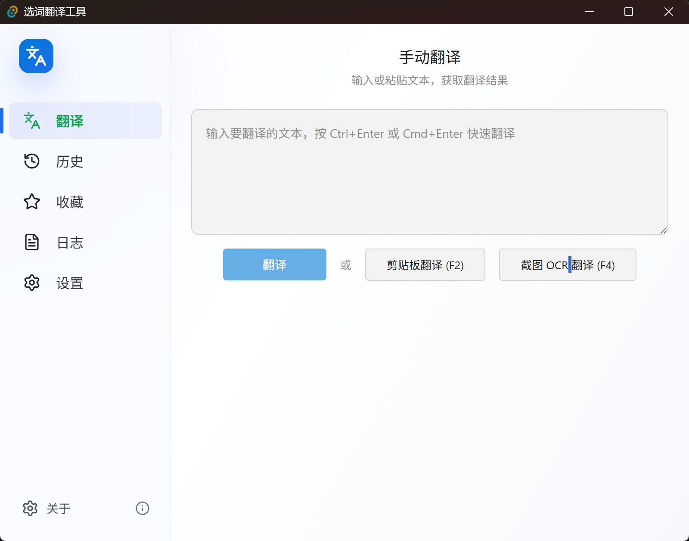
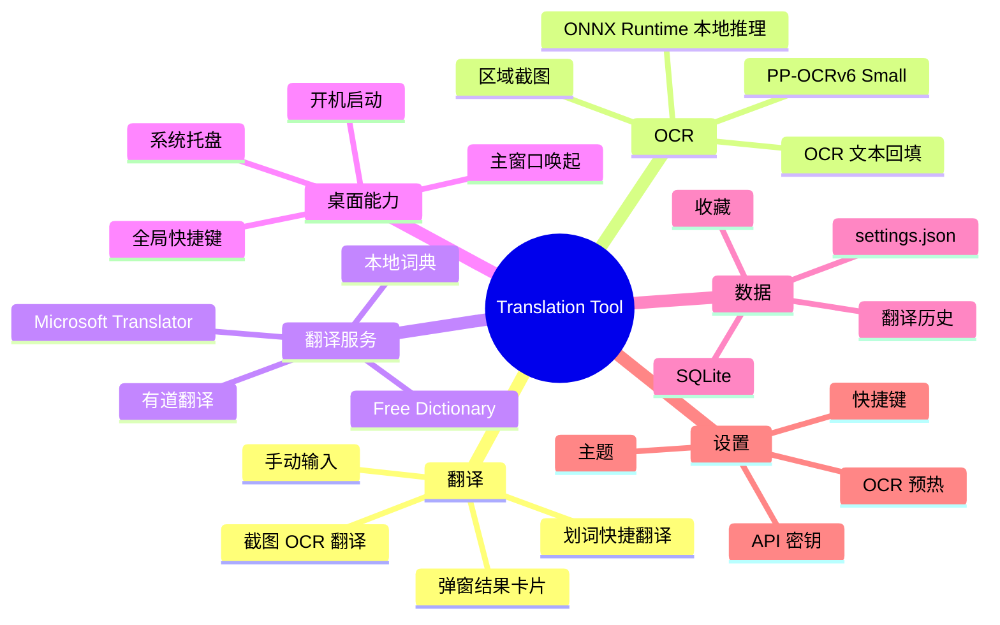
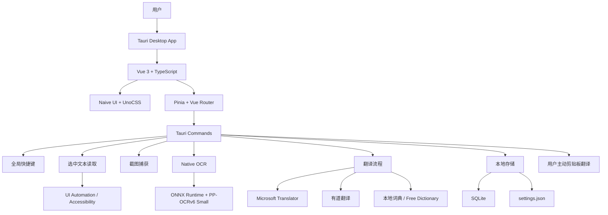
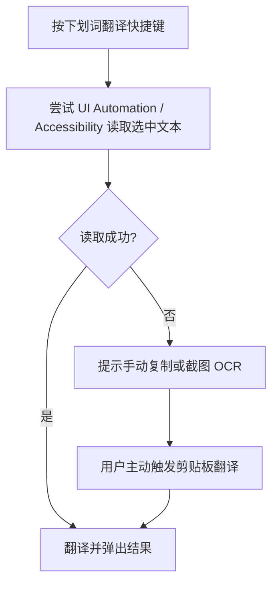

# Translation Recording Tool

一个基于 `Tauri 2 + Vue 3 + Rust + SQLite` 的 Windows / macOS 桌面翻译工具，面向日常划词翻译、截图 OCR 翻译、历史记录和本地词典查询。

当前开发版本：`v0.4.0`（新增 macOS 构建与原生 OCR）

- Windows 安装包：`translation-tool_0.4.0_x64-setup.exe` / `translation-tool_0.4.0_x64_en-US.msi`
- macOS 便携包：`translation-tool.app`（压缩为 `.zip`）或 `translation-tool_0.4.0_aarch64.dmg`

## 产品预览



## 核心能力

- 划词翻译：Windows 默认 `Ctrl+Q`，macOS 默认 `Option+Command+T`。
- 无剪贴板优先：Windows 使用 UI Automation、macOS 使用 Accessibility API 直接读取当前选中文本。
- 安全取词：如果目标应用不支持 UI Automation，默认不自动模拟 `Ctrl+C`；可在设置中显式开启“读取失败时自动复制并翻译”（会覆盖当前剪贴板内容，不恢复）。
- 截图 OCR 翻译：Windows 默认 `Ctrl+Shift+Q`，macOS 默认 `Option+Command+O`；截图后 OCR、翻译并弹出结果卡片。
- OCR 原文回填：截图 OCR 识别出的文本会同步到主界面输入框，方便手动修正。
- 本地词典优先：单词优先查本地 `ECDICT + WordNet`，再用 Free Dictionary 补全音标、例句等信息。
- 在线翻译：支持有道、Microsoft Translator、Google Translate，以及无需 Key 的 Google / 微软免费通道。
- 历史与收藏：翻译记录、收藏、配置保存在本地。
- 系统托盘：支持关闭时最小化到托盘。

## v0.4.0 亮点

- 新增 macOS（Apple Silicon）原生构建：`.app` 便携包与 `.dmg`，不再依赖 Windows PowerShell 准备脚本。
- OCR 运行库按平台自动选择 `onnxruntime.dll` / `onnxruntime.dylib`，模型与 ONNX Runtime 仍固定版本并校验 SHA-256。
- macOS 使用 Accessibility API 读取选中文本；剪贴板回退在 macOS 上使用 `Command+C` 并通过 `NSPasteboard.changeCount` 检测更新。
- macOS 默认快捷键避开系统保留的 `Command+Q` / `Command+Shift+Q`，并补充辅助功能与屏幕录制授权说明。
- 新增跨平台 `prepare_ocr_models.mjs` / `prepare_ort_runtime.mjs`，Windows 原有 PS1 流程保持不变。

## v0.3.1 亮点

- 没选中任何文本时按划词快捷键不再弹窗，直接静默忽略。
- 修正“选区为空”与“应用不支持读取”被当成同一种失败的问题，空选区不再触发报错。
- 开启“自动复制并翻译”后，自动复制没取到内容同样视为未选中，不再弹出与开关状态矛盾的旧提示。
- 未检测到选中文本时不再作废当前已打开的翻译弹窗。

## v0.3.0 亮点

- 新增 Google / 微软免费翻译通道，无需 API Key 即可直接使用。
- Chrome / Edge 划词读取兼容焦点落在容器上的场景，减少“未能读取选中文本”。
- 新增可选“读取失败时自动复制并翻译”，开启后通过 `Ctrl+C` 读取选区。
- Google 官方翻译配额/速率错误会区分每分钟限制与每日配额，并给出处理方向。
- 句子翻译弹窗改为内容自适应高度，重做句子、错误和单词模式的间距与排版。
- 旧版 `settings.json` 会随应用标识变更一起迁移，避免配置和 Key 丢失。
- 有道控制台字段按官方术语调整，并明确「API Key」不参与文本翻译 v3 签名。

## v0.2.1 亮点

- 新增 Google Translate 配置与调用链路。
- 截图选择防重入：进行中拒绝重复触发，避免叠多层选区。
- 截图右键确认，Esc 仍取消。
- 主题收敛为 Light / Dark，并重做完整暗色 token。
- OCR 只保留原生 ONNX 主线，去掉 sidecar 兼容入口。

## v0.2.0 亮点

- OCR 主线切换为 `ONNX Runtime + PP-OCRv6 small`，不再依赖 Python/PaddleOCR 打包链。
- Windows 安装包体积降到约 `33 MB`。
- 划词翻译新增 Windows UI Automation 读取选区文本，能用时不污染剪贴板。
- 设置页重构为 `Naive UI + UnoCSS + @lucide/vue`。
- 截图 OCR 后会继续自动翻译，同时把 OCR 文本放到主界面输入栏。

## 功能结构



## 架构概览



## 使用说明

### 安装

Windows 用户从 Release 页面下载 `.exe` 安装包（普通用户推荐）或 `.msi`（适合批量部署）。

macOS 用户下载 `translation-tool_0.4.0_aarch64.dmg`，把 `translation-tool.app` 拖入“应用程序”；也可以直接解压便携 `.zip` 后运行，无需安装。

### 配置翻译服务

打开设置页，在“翻译服务”中选择：

- 有道翻译：填写控制台里的「应用 ID（App Key）」和「应用密钥（App Secret）」；「API Key」用于有道大模型等其他接口，不参与文本翻译 v3 签名，无需填写。
- 微软翻译：填写 `Microsoft Translator Key` 和 `Region`。
- Google 翻译：填写 `Google Cloud Translation API Key`。
- Google / 微软免费通道：无需 Key，直接使用公开翻译接口。适合个人临时使用，可能受网络环境、频率限制或上游接口变动影响；需要稳定服务时仍建议配置官方 Key。

单词查询会优先走本地词典；句子翻译、本地词典未命中、截图 OCR 翻译结果会使用当前选择的在线翻译服务。

### 划词翻译

1. 在任意应用中选中文字。
2. 按默认快捷键：Windows `Ctrl+Q`，macOS `Option+Command+T`。
3. 应用优先通过 Windows UI Automation / macOS Accessibility API 读取选中文本。
4. 如果检测到当前没有选中任何文本，直接忽略本次快捷键，不弹窗。
5. 如果读取失败，默认提示手动复制后使用剪贴板翻译；在设置中开启“读取失败时自动复制并翻译”后，应用会显式发送 `Ctrl+C`（macOS 为 `Command+C`）并读取剪贴板，自动复制同样没取到内容时按“未选中”处理。
6. 翻译结果会以自适应高度的弹窗卡片展示。



注意：选区读取依赖目标软件暴露选中文本（Windows UI Automation / macOS Accessibility）。浏览器、系统输入框、Office、标准控件通常支持较好；图片、视频字幕、游戏、自绘 UI、部分 PDF 页面仍建议用截图 OCR。macOS 首次使用需在“系统设置 → 隐私与安全性 → 辅助功能”中允许本应用。

### 截图 OCR 翻译

1. 按截图快捷键（Windows `Ctrl+Shift+Q`，macOS `Option+Command+O`）或点击截图 OCR 入口。
2. 框选屏幕区域。
3. 识别完成后，OCR 文本会进入主界面输入框。
4. 应用会继续自动翻译，并在截图区域附近弹出翻译卡片。

当前推荐 OCR 引擎为：

```text
native_onnx / PP-OCRv6 small / ONNX Runtime
```

这个方案不需要额外启动 Python OCR 服务。打包版会带上平台对应的 ONNX Runtime 动态库（Windows `onnxruntime.dll` / macOS `onnxruntime.dylib`）和 PP-OCRv6 small 模型。

## 技术栈

- 桌面壳：`Tauri 2`
- 前端：`Vue 3`、`TypeScript`、`Pinia`、`Vue Router`
- UI：`Naive UI`、`UnoCSS`、`@lucide/vue`
- 后端：`Rust`
- 数据库：`SQLite`
- OCR：`ONNX Runtime`、`PP-OCRv6 small`
- 翻译服务：有道翻译、Microsoft Translator、Google Translate、Google/微软免费通道、Free Dictionary
- 本地词典：`ECDICT`、`WordNet`

## 目录结构

```text
Translationrecordingtool/
├── src/                         # Vue 前端
│   ├── components/              # 公共组件
│   ├── lib/                     # 前端工具与默认配置
│   ├── router/                  # 路由
│   ├── stores/                  # Pinia 状态管理
│   └── views/                   # 主页面、设置页、截图选择页、详情页
├── src-tauri/
│   ├── binaries/                # 打包用原生运行时，如 onnxruntime.dll / onnxruntime.dylib
│   ├── resources/               # 字典库、OCR 模型等资源
│   ├── src/
│   │   ├── clipboard.rs         # 剪贴板读写和更新等待
│   │   ├── database.rs          # SQLite 翻译记录
│   │   ├── local_dictionary.rs  # 本地词典查询与合并
│   │   ├── native_ocr.rs        # 原生 ONNX OCR
│   │   ├── ocr.rs               # OCR 调用入口
│   │   ├── popup_window.rs      # 弹窗定位和展示
│   │   ├── screenshot.rs        # 截图选择与捕获
│   │   ├── selection_reader.rs  # UI Automation / Accessibility 读取选中文本
│   │   ├── shortcut_handler.rs  # 全局快捷键流程
│   │   └── translator.rs        # 在线翻译服务
│   └── tests/                   # Rust 集成测试
├── scripts/                     # 字典、OCR 模型、运行时准备脚本
├── docs/                        # 项目文档
└── README.md
```

## 开发环境

需要：

- Node.js ≥24.0.0（推荐 24 LTS；当前仅实测 24.14.1）。package.json 的 engines 要求 `>=24.0.0`，开启 engine-strict 时会拒绝 20/22。部分上游依赖仍声明 20/22 的 engine 范围，但本项目不将 20/22 列为受支持版本。
- Rust stable ≥1.90（当前 Tauri 配套依赖要求；不代表已实测所有符合该范围的工具链）
- **Windows**：Tauri 2 Windows 依赖（MSVC Build Tools、WebView2）和 PowerShell
- **macOS**：Xcode Command Line Tools（或完整 Xcode）与 Rust 的 `aarch64-apple-darwin` 目标

安装依赖：

```bash
npm install
```

### 准备模型、运行库和词典

个人使用直接运行下面的准备命令即可，**不需要 `release-assets.json` 或人工审批**。默认从官方固定版本/revision 下载，保留临时下载、格式检查和失败不覆盖原文件的保护；OCR 模型只准备 `small`，并核对内置的官方来源 SHA-256。

ONNX Runtime 固定为 1.20.1：Windows 使用 x64 DLL，macOS 使用官方 arm64 动态库；两者都校验下载包 SHA-256。ECDICT 固定 commit，WordNet 固定 3.0，检查输入结构后再生成词典。上游没有提供可用摘要的文件不伪造校验值，也不宣称已做独立供应链认证。

如需更严格的自定义校验，可显式传入 `-ManifestPath`（PowerShell）或 `--manifest`（词典）。这只是高级可选模式：指定了无效/缺失清单或 synthetic 测试清单会报错，默认流程不会读取它。

生成本地词典：

```bash
npm run build:dictionary
```

准备 PP-OCRv6 small 模型和 ONNX Runtime（跨平台）：

```bash
npm run ocr:models          # 模型，校验每个文件的 SHA-256
npm run ocr:ort             # Windows x64 下载 DLL / macOS arm64 下载 dylib（固定 1.20.1，校验 SHA-256）
```

Windows 仍可使用原有 PowerShell 流程：

```bash
npm run ocr:models:win -- -Profile small
npm run ocr:ort:win
```

启动开发版：

```bash
npm run tauri -- dev --config src-tauri/tauri.ocr-native.conf.json   # Windows
npm run tauri -- dev --config src-tauri/tauri.ocr-native.macos.conf.json   # macOS
```

启动细节、成功判断标准，以及**非交互环境**（进程管理器 / CI / 直接 spawn）下为什么不能裸调 `npm` 的说明，见 [docs/dev-startup.md](docs/dev-startup.md)。

## 打包

Windows：

```bash
npm run tauri:build:ocr:native
```

这个命令会：

1. 准备 PP-OCRv6 small ONNX 模型。
2. 准备 `onnxruntime.dll`。
3. 构建前端。
4. 构建 Tauri release。
5. 生成 Windows `.exe` 和 `.msi` 安装包。

macOS（Apple Silicon）：

```bash
npm run tauri:build:ocr:mac
```

这个命令会：

1. 准备 PP-OCRv6 small ONNX 模型。
2. 下载并校验 `onnxruntime.dylib`（ONNX Runtime 1.20.1 arm64）。
3. 构建前端与 Tauri release。
4. 生成 `.app`、`.dmg`，脚本会再打成便携 `.zip`。

产物位置：

```text
# Windows
src-tauri/target/release/bundle/nsis/translation-tool_0.4.0_x64-setup.exe
src-tauri/target/release/bundle/msi/translation-tool_0.4.0_x64_en-US.msi

# macOS
src-tauri/target/release/bundle/macos/translation-tool.app
src-tauri/target/release/bundle/dmg/translation-tool_0.4.0_aarch64.dmg
src-tauri/target/release/bundle/dmg/translation-tool_0.4.0_aarch64-portable.zip
```

### GitHub Actions 自动发布（Windows + macOS）

推送 `v*` 格式的 tag（例如 `v0.4.0`）会触发 `.github/workflows/release.yml`：Windows 和 macOS 两台 runner 并行准备模型、ONNX Runtime 与词典并打包，然后把 `.exe`、`.msi`、`.dmg`、便携 `.zip` 一起上传到同名 GitHub Release。也可以在 Actions 页面手动运行做试打包（只上传构建产物，不创建 Release）。

```bash
git tag v0.4.0
git push origin v0.4.0
```

### macOS 有便携版吗？

有，但形态与 Windows 不同：macOS 不需要安装器，`.app` 本身就是可移动的应用包。把 `translation-tool.app` 拖到任意目录（包括 U 盘或移动硬盘）即可运行；压缩成 `.zip` 也能保留 bundle 结构与可执行权限。`.dmg` 只是分发容器，不是运行必需。

需要注意：

- 本构建未做 Apple Developer ID 签名与公证，首次打开可能被 Gatekeeper 拦截。请在 Finder 中右键 →“打开”，或执行 `xattr -dr com.apple.quarantine /path/to/translation-tool.app`。
- 当前构建目标为 Apple Silicon（`aarch64`），Intel Mac 需另行交叉编译或使用 Rosetta 运行 x64 构建。
- 首次使用划词翻译需授权“辅助功能”，首次截图 OCR 需授权“屏幕与系统音频录制”。本构建为 ad-hoc 签名，macOS 不会自动弹窗也不会自动把应用加入列表：请在“系统设置 → 隐私与安全性 → 屏幕与系统音频录制”点“+”手动添加 `translation-tool.app`，打开开关后重启应用（应用会在缺少权限时自动打开该设置页并在 Finder 中定位自身）。

## 常用命令

```bash
npm run build:dictionary        # 生成离线 dictionary.db
npm run ocr:models              # 准备 OCR 模型（跨平台）
npm run ocr:ort                 # 准备 ONNX Runtime（Windows / macOS，跨平台）
npm run ocr:models:win          # 准备 OCR 模型（PowerShell）
npm run ocr:ort:win             # 准备 ONNX Runtime DLL（Windows）
npm run tauri:build:ocr:native  # 打包 Windows 版本（PowerShell 准备脚本）
npm run tauri:build:ocr:win     # 打包 Windows 版本（Node 准备脚本，CI 使用）
npm run tauri:build:ocr:mac     # 打包 macOS .app/.dmg/便携 zip
npm run build                   # 前端构建
npm run test                    # 前端单元测试
npm run tauri dev               # 普通 Tauri 开发模式
npm run check:rust -- --locked # Rust 测试环境编译检查
npm run test:rust -- --locked  # Rust 测试（无需发布资源）
npm run test:rust-wrapper      # 测试入口自身回归
npm run test:dependencies      # 合成依赖兼容测试与本地浏览器 HMR
```

当前产品仅支持原生 ONNX OCR 的 `small` profile；旧配置中的其他 profile 在加载时统一迁移为 `small`，不再提供 Paddle/Rapid sidecar 打包路径。

`test:rust`/`check:rust` 只给 Cargo 子进程合并 `TAURI_CONFIG.bundle.resources=[]`，不会修改正式打包配置，也不会生成假的资源文件。其他已有配置字段和 `CARGO_TARGET_DIR` 保持继承；磁盘空间不足时可由调用者指定构建目录。发布构建仍必须准备真实词典、模型及平台动态库；测试通过不代表发布资产完整。

## 数据存储

运行时数据保存在 Tauri 应用数据目录中，主要包括：

- 翻译历史
- 收藏状态
- 用户配置
- OCR/翻译相关运行日志

静态资源包括：

- `src-tauri/resources/dictionary.db`
- `src-tauri/resources/ocr-models/small/**/*`
- `src-tauri/binaries/onnxruntime.dll`（Windows）
- `src-tauri/binaries/onnxruntime.dylib`（macOS）

这些大体积生成资源通常不适合直接人工维护，建议通过脚本生成或刷新。

## 已知限制

- 选区读取（Windows UI Automation / macOS Accessibility）不能覆盖所有应用。读不到选中文字时需要手动复制后触发剪贴板翻译，或改用截图 OCR。
- 为避免覆盖用户并发复制的内容，已取消划词失败后的自动复制及剪贴板恢复。主动复制译文等明确操作仍会写入剪贴板。
- 截图 OCR 依赖模型能力，复杂背景、小字号、低清晰度图片可能需要手动修正。
- 官方 API 通道需要外部 API Key；也可以选择无需 Key 的 Google/微软免费通道，但该通道为公开接口，稳定性和频率上限不受本应用控制。
- 当前正式支持 Windows 与 macOS（Apple Silicon）；Linux 分支保留但未完成目标编译及原生行为验证，不承诺可用于生产。
- macOS 构建未签名、未公证，分发时需按上文处理 Gatekeeper；也暂未提供 Intel / Universal 构建。

## 隐私说明

- 历史记录、收藏和配置默认保存在本机。
- 单词优先查本地词典；词典资源缺失或读取失败会明确报错，不自动向在线服务降级。正常查无词仍按既有流程调用在线服务。
- 句子翻译、本地未命中、截图 OCR 后的翻译会调用当前配置的在线翻译服务；选择免费通道时，原文会发送到 Google / Microsoft 的公开翻译接口。
- 运行日志不记录原文、译文、完整服务响应或敏感查询 URL；历史记录与运行日志是不同的数据存储。
- API Key 只应保存在本机配置中，不要提交到 Git。

## 许可证

当前仓库尚未包含明确的 license 文件。正式分发或接受外部贡献前，建议补充明确的开源协议。

第三方词典、模型和在线服务请分别遵守各自上游许可：

- ECDICT
- WordNet
- Free Dictionary API
- PP-OCRv6
- ONNX Runtime
